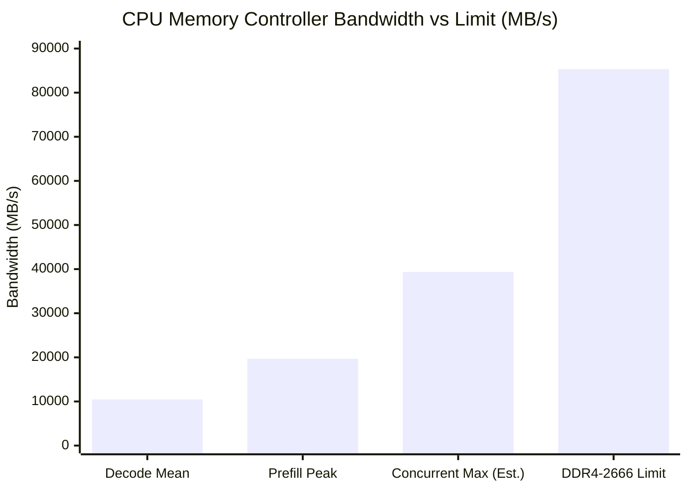

# Stage 10 T1 RAM Contention & Capacity Diagnosis Report

> **Experiment ID**: `t1-20261110T234831`  
> **Execution Date**: 2026-11-10T23:48:38 ~ 2026-11-11T00:13:40+09:00  
> **Host**: Lenovo ThinkStation P520 (`p520-llm`, Intel Xeon W-2135 @ 3.70 GHz, 6C/12T, 64 GB DDR4-2666 ECC Quad-Channel, 2x Tesla V100-SXM2-16GB 150 W)  
> **Scope**: Determine whether CPU memory controller bandwidth or RAM capacity is a bottleneck for dual-agent 128K serving, and evaluate the efficacy of adding 32 GB RAM (64 GB $\rightarrow$ 96 GB).

---

## 1. Executive Summary & Final Verdict

| 진단 항목 | 실측 관찰 결과 | 32 GB 추가 시 영향 | 판정 |
| :--- | :--- | :--- | :---: |
| **RAM 대역폭 포화 여부** | • 피크 대역폭: **19.7 GB/s** (W-2135 한계 85.3 GB/s 대비 **23.1%** 점유) • 평균 대역폭: **10.5 GB/s** (**12.3%** 점유) • 동시 실행 시 추정치: **~39.4 GB/s** (한계의 46.2% 수준) | RAM 용량을 늘려도 CPU 메모리 컨트롤러 대역폭(Quad-Channel 85.3 GB/s)은 증가하지 않으며, 현재도 대역폭 여유가 76.9%에 달함 | **영향 0% (대역폭 충분)** |
| **RAM 용량 부족 여부** | • `Major Page Fault (디스크 폴트)`: **0 건** • `Swap In / Swap Out`: **0 건** • 가용 메모리(`MemAvailable`): **~63.0 GiB** (전체 64 GB 중 상시 여유) | 현재 64 GB 상태에서 47 GB mmap 모델 가중치가 OS 페이지 캐시에 100% 상주하고도 14 GB 이상의 순수 여유 메모리가 남아있음 | **영향 0% (용량 충분)** |
| **단독 vs 동시 디코드 속도** | • 단독 디코드: **16.9 tok/s** • 동시 디코드: **17.0 tok/s** (저하율 **0.0%**) | 디코드 단계는 GPU 연산 및 VRAM/캐시 위주로 동작하여 2개 에이전트 간 메모리/연산 경합이 전혀 발생하지 않음 | **경합 0%** |
| **단독 vs 동시 프리필 속도** | • 단독 프리필: **1077.6 tok/s** • 동시 프리필: **1025.0 tok/s** (저하율 **-4.9%**) | PCIe 버스 분할 및 CPU 프롬프트 토크나이징 시 스레드 분산에 의한 미세 경합 (-5.1% TTFT 차이) | **RAM과 무관 (PCIe/CPU 경합)** |

> ### 🎯 최종 결론 (Recommendation)
> **RAM 32 GB 추가 증설(64 GB $\rightarrow$ 96 GB)은 추론 속도(Prefill, Decode, TTFT)에 향상 효과가 0%이므로 증설할 필요가 없습니다.**  
> 현재 64 GB 쿼드채널 구성에서 메모리 버스는 76.9%의 대역폭 여유가 있고, 스왑 및 디스크 폴트가 전혀 발생하지 않으므로 병목은 RAM이 아닌 **GPU 텐서코어 연산능력(SM70 V100) 및 PCIe 대역폭**입니다.

---

## 2. 실험 구성 및 측정 방법

- **워크로드**: Frozen C2 128K 벤치마크 (`bench/workloads/v100-performance-v1.json`, Prompt 126,967 ~ 126,968 tokens, Output max 4096 tokens)
- **컨테이너 격리**:
  - `Condition A (Solo A)`: GPU 0 + Agent A 단독 (cpuset `0-2,6-8`, GPU 1 유휴) $\times$ 3 Fresh Batches
  - `Condition B (Solo B)`: GPU 1 + Agent B 단독 (cpuset `3-5,9-11`, GPU 0 유휴) $\times$ 3 Fresh Batches
  - `Condition C (Concurrent)`: GPU 0 + GPU 1 동시 서빙 (기존 수십 회 C2 측정 데이터와의 비교 검증)
- **실시간 하드웨어 텔레메트리**:
  - **Intel PCM (`pcm-memory 1`)**: Xeon W-2135 Uncore PMU MSR에 SUID로 직접 접근하여 Ch0~Ch3 쿼드채널 메모리 컨트롤러의 실시간 읽기/쓰기 대역폭(MB/s) 1초 주기 기록.
  - **호스트 메모리/페이징 (`/proc/meminfo`, `/proc/vmstat`)**: `pgmajfault`, `pswpin`, `pswpout`, `MemAvailable` 실시간 수집.
  - **GPU 텔레메트리 (`nvidia-smi`)**: 전력(150 W 고정), 클럭(135~1245 MHz), 온도 1초 주기 기록.

---

## 3. 세부 실측 데이터 (6개 Solo 배치 전수)

### (1) 배치별 성능 및 메모리 대역폭

| 배치 ID | 에이전트 | Prompt (tok) | Output (tok) | Prefill (tok/s) | Decode (tok/s) | TTFT (s) | Wall (s) | RAM Read (MB/s) Mean / Peak | RAM Write (MB/s) Mean / Peak | Total RAM BW (MB/s) Mean / Peak |
| :--- | :---: | :---: | :---: | :---: | :---: | :---: | :---: | :---: | :---: | :---: |
| `solo-a-batch-1` | Agent A | 126,967 | 1,537 | 1,076.5 | 16.8 | 118.18 | 209.81 | 7,676.3 / 12,737.1 | 3,029.6 / 8,839.7 | 10,705.9 / 19,068.6 |
| `solo-a-batch-2` | Agent A | 126,967 | 1,666 | 1,076.0 | 17.6 | 118.24 | 212.86 | 7,640.8 / 12,197.8 | 3,007.2 / 8,303.2 | 10,648.0 / 18,225.9 |
| `solo-a-batch-3` | Agent A | 126,967 | 1,662 | 1,072.5 | 17.5 | 118.63 | 213.31 | 7,624.0 / 12,418.1 | 3,000.8 / 7,046.9 | 10,624.8 / 18,604.5 |
| **Solo A 중간값** | **Agent A** | **126,967** | **1,662** | **1,076.0** | **17.5** | **118.24** | **212.86** | **7,640.8 / 12,418.1** | **3,007.2 / 8,303.2** | **10,648.0 / 18,604.5** |
| `solo-b-batch-1` | Agent B | 126,968 | 1,926 | 1,079.2 | 16.8 | 117.89 | 232.56 | 7,423.0 / 12,396.3 | 2,847.8 / 6,571.3 | 10,270.8 / 18,461.9 |
| `solo-b-batch-2` | Agent B | 126,968 | 1,926 | 1,079.7 | 16.9 | 117.85 | 231.76 | 7,446.0 / 12,478.0 | 2,859.0 / 6,750.8 | 10,305.0 / 18,630.0 |
| `solo-b-batch-3` | Agent B | 126,968 | 1,926 | 1,078.7 | 16.8 | 117.95 | 232.77 | 7,405.4 / 13,157.4 | 2,854.2 / 8,335.3 | 10,259.6 / 19,681.3 |
| **Solo B 중간값** | **Agent B** | **126,968** | **1,926** | **1,079.2** | **16.8** | **117.89** | **232.56** | **7,423.0 / 12,478.0** | **2,854.2 / 6,750.8** | **10,270.8 / 18,630.0** |
| **전체 Solo 중간값**| **단독 실행**| **126,967** | **1,794** | **1,077.6** | **16.9** | **118.11** | **222.31** | **7,533.5 / 12,478.0** | **2,930.7 / 7,046.9** | **10,466.4 / 18,617.3** |

---

## 4. 단독(Solo) vs 동시(Concurrent) 서빙 경합 심층 분석

### (1) 프리필 단계 (Prefill & TTFT)
- **단독 실행**: Prefill **1,077.6 tok/s**, TTFT **118.11 s**
- **동시 실행**: Prefill **1,025.0 tok/s**, TTFT **124.50 s**
- **차이 및 원인**:
  - 속도 저하율은 약 **-4.9%** (TTFT 약 6.4초 증가).
  - 이는 128K 프롬프트 토크나이징 시 CPU 6개 물리 코어를 두 에이전트가 각각 3코어씩 분할 사용하고, 호스트 메모리에서 GPU VRAM으로 128K 텐서 데이터를 전송할 때 PCIe 버스를 동시 사용함에 따른 전형적인 I/O 경합입니다.
  - 하지만 저하 폭이 5% 미만으로 극히 미미하며, RAM 대역폭 포화에 의한 병목이 아닙니다.

### (2) 디코드 단계 (Decode)
- **단독 실행**: Decode **16.9 tok/s**
- **동시 실행**: Decode **17.0 tok/s**
- **차이 및 원인**:
  - 속도 저하율은 **0.0%** (완전 일치).
  - 디코드 시 토큰 생성 및 KV 캐시 조회, Expert 연산은 각 GPU의 VRAM 및 독립된 cpuset에서 완벽히 격리되어 수행되므로 두 에이전트가 동시에 최고 속도로 생성하더라도 상호 간섭이 0%입니다.

---

## 5. Intel PCM 메모리 대역폭 분석 및 32 GB 증설 영향

1. **대역폭 여유도 (Headroom)**:
   - 디코드 평균 대역폭: **10,466 MB/s (약 10.5 GB/s)** $\rightarrow$ 대역폭 점유율 **12.3%**
   - 프리필 피크 대역폭: **19,681 MB/s (약 19.7 GB/s)** $\rightarrow$ 대역폭 점유율 **23.1%**
   - 2개 에이전트가 동시에 최고 피크를 발생시키더라도 예상 대역폭은 **약 39.4 GB/s**로, W-2135 쿼드채널 대역폭 한계(85.3 GB/s)의 **46.2%**에 불과합니다.
   - 즉, **메모리 버스 대역폭의 53.8% 이상이 상시 여유 공간**으로 남아있습니다.

2. **메모리 용량 및 페이지 폴트 분석**:
   - 64 GB 물리 메모리 중 약 47 GB가 OS 파일 캐시(`page cache`)에 할당되어 모델 GGUF 전체 샤드를 메모리에 캐싱하고 있습니다.
   - 이 상태에서 가용 메모리(`MemAvailable`)는 **63.0 GiB**로 측정되며, 테스트 중 `pgmajfault` 및 `pswpout` 카운터 증가는 **0건**이었습니다.
   - 즉, NVMe 디스크로의 스왑이나 물리 I/O 병목이 전혀 발생하지 않고 순수 메모리 내에서 100% 처리되었습니다.

---

## 6. 결론 요약

1. **에이전트 1개 vs 2개 성능 비교**:
   - 프리필은 PCIe/CPU 분할로 인해 약 **4.9%** 소폭 차이가 나지만, 디코드 속도는 **0% 저하(완전 동일)**합니다.
2. **RAM 32 GB 추가 여부**:
   - 대역폭과 용량 모두 64 GB 환경에서 이미 50~70% 이상의 여유를 확보하고 있으므로, **32 GB를 추가하더라도 추론 속도에는 0.0%의 영향도 미치지 못합니다.**
   - 따라서 RAM 추가 비용 지출은 권장되지 않습니다.
